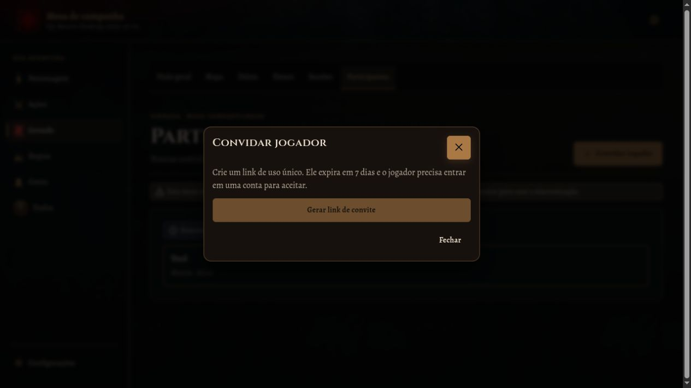
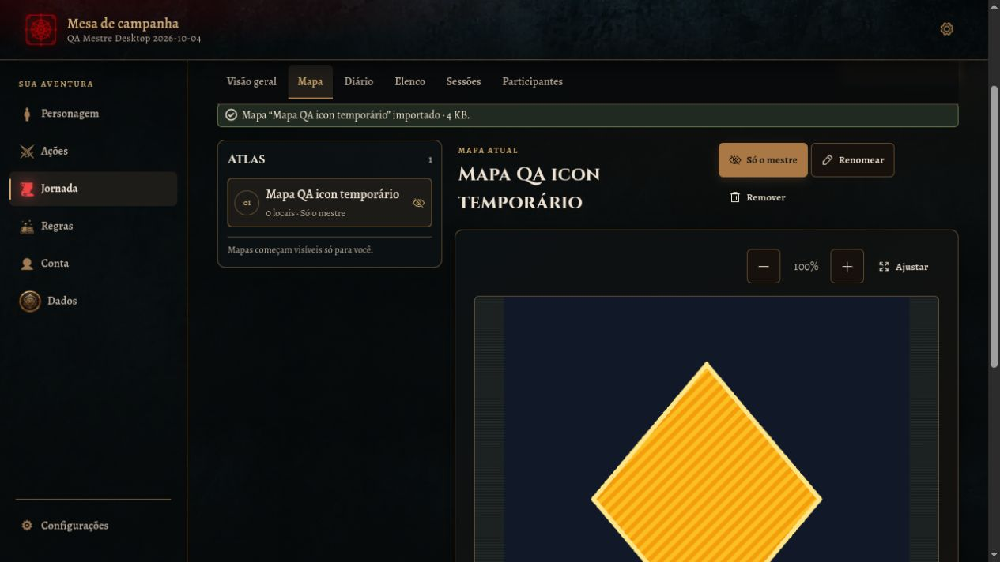
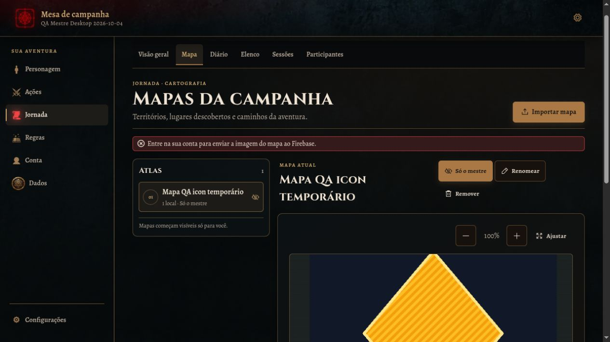
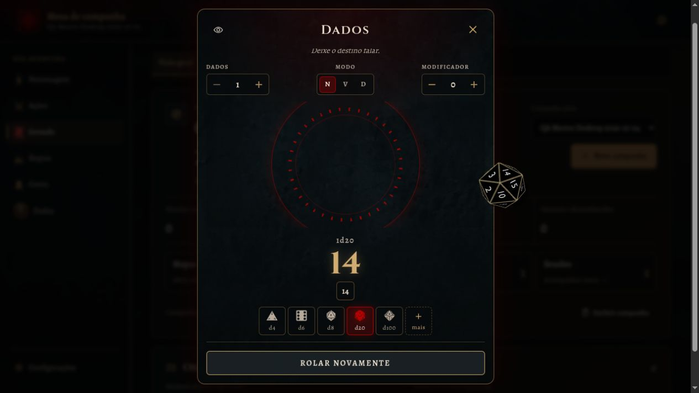
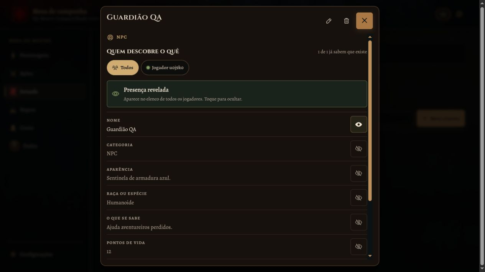
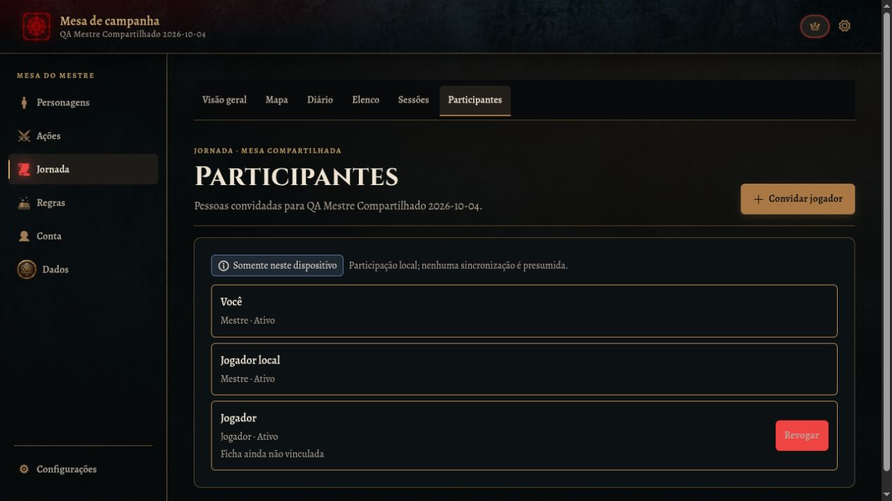

# Avaliação do mestre — desktop

**Data:** 04/10/2026  
**Ambiente:** RPG Companion em `http://localhost:5173`, navegador Codex IAB, viewport observado de 1265 × 712 px. Sem alterações no código do produto. Dados de mesa, NPCs e contas usados foram sintéticos de QA.

## Resultado

Os fluxos locais de campanha, mapa, diário, elenco, sessão, iniciativa, rolagem e compêndio são utilizáveis. Convite e entrada de jogador funcionaram; presença e revelação granular de NPC chegaram à conta do jogador. A colaboração permanece parcial: gravações de mapa e diário foram recusadas pelo Firestore, então jogador e mestre divergiram após salvar. A UI ainda mostra “ao vivo” em alguns pontos e “somente neste dispositivo” em outros.

## Cobertura e evidências

- **Conta e mesa.** Perfil local iniciou sem autenticação. Primeira criação de conta QA falhou com `Firebase: Error (auth/network-request-failed)`; tentativa posterior com os mesmos dados sintéticos autenticou e permitiu salvar perfil Mestre QA. O login tentado antes de concluir o cadastro retornou “Email ou senha não conferem”. Console do IAB não mostrou logs de auth. Não foi possível atribuir a primeira falha a uma causa; não repetir indefinidamente.
- **Painel e campanha.** Criada campanha local `QA Mestre Desktop 2026-10-04` antes do login e campanha `QA Mestre Compartilhado 2026-10-04` após autenticar. Visão geral mostra resumo e atalhos para mapa, diário, elenco e sessões; a campanha ativa pode ser alternada. Em ambas, Objetivos e Missões mostram zero e nenhum comando de criação foi encontrado nessa tela.
- **Convite e membro.** Offline, o botão de gerar link fica desabilitado e a tela informa que convites não chegam a outro navegador. Autenticado, link de uso único com validade de 7 dias foi gerado e aceito pela conta QA Jogador no Chrome/4173. Mestre passou a ver `Jogador · Ativo`, `Ficha não vinculada` e uma jornada de jogador. Após reload, membro continuou ativo. Não registrar o link/token neste relatório.
- **Estado de sincronização contraditório.** Depois da entrada do jogador, o cabeçalho mostra `Mestre da campanha · ao vivo`, mas Participantes ainda mostra `Somente neste dispositivo` e `Participação local; nenhuma sincronização é presumida`. A jornada do jogador apareceu mesmo assim. Tratar o indicador “ao vivo” com cautela: não prova que todas as coleções sincronizam.
- **Mapa local.** Importado PNG de QA (512 × 512 px, 4 KB); nome opcional, confirmação de importação e prévia funcionaram. Mapa começa privado (`Só o mestre`). Zoom passou a 125% e `Ajustar mapa` retornou a 100%. `Marcar local` abriu formulário com coordenadas relativas; salvo `Ruínas QA` em 49% horizontal / 68% vertical e a lista passou a indicar 1 local. O botão de centralização ficou habilitado.
- **Publicação do mapa.** No primeiro mapa, ainda sem login, salvar visibilidade `Todos os jogadores` retornou `Entre na sua conta para enviar a imagem do mapa ao Firebase`; cancelei e o mapa privado foi preservado. Depois, já autenticado e com jogador ativo, importar `Mapa QA compartilhado` iniciou como `Enviando ao Firebase…`; o cabeçalho mudou para `Mestre da campanha · sem conexão` e não concluiu, deixando os controles de visibilidade desabilitados. Log do navegador (aprox. 18:26, horário Cuiabá) registra Firestore `permission-denied` ao criar `campaigns/{campanhaQA}/maps/{mapaQA}` e aviso de coleção recusada pelas regras. Após reload, o jogador continuava sem mapa e via “O mestre ainda não liberou nenhum mapa para você”. Não alterei rules/config.
- **Diário local.** Criado e salvo `Relato QA — sessão inicial`, sessão 1, tags `QA, pista`. UI passou de `Alterações pendentes` para `Salvo localmente`; busca por `pista` encontrou o registro e termo inexistente mostrou estado vazio orientando a trocar termo/tag.
- **Diário entre contas.** Jogador salvou `QA jogador: sinal no cais`; o registro persistiu na sessão local dele após reload. No mestre, a lista permaneceu em zero após reload. Console do jogador registrou Firestore `permission-denied` ao criar `campaigns/{campanhaQA}/journals/{registroQA}`. Assim, título/fonte → destino não sincronizou: jogador Chrome/4173 vê 1 registro local; mestre IAB/5173 vê 0. Relatos do jogador são filtráveis por `Todos`, `Meu diário` e participante.
- **Elenco e revelação.** Criado NPC local `Nira Vell (QA)` com campos públicos/privados. Sem jogador ativo, card indica `Oculto` e detalhe explica que os controles de revelação surgem quando jogadores entram. Na campanha com jogador ativo, criado `Guardião QA`; seletor Todos/Jogador e checkboxes por campo permitem revelar presença/nome. Após revelar apenas nome, mestre viu `1 de 1 já sabem que existe`; nota do mestre é marcada `Só você vê`. Jogador confirmou após reload que o NPC aparece com nome e pista genérica, categoria desconhecida e detalhes ocultos. Este fluxo sincronizou; não generalizar para mapa/diário.
- **Sessões e iniciativa.** Campanha local: sessão QA criada como `Planejada`, notas salvas localmente, `Iniciar` mudou para `Em andamento`. Adicionado NPC com iniciativa 15; `Próximo turno` marcou o participante e `Nova rodada` avançou para rodada 2. Também criada sessão na campanha autenticada; continua `Somente neste dispositivo` / `Sessão criada localmente e aguardando sincronização`. Player não tem abas Sessões/Participantes, então leitura da sessão pelo jogador não foi possível. O registro do encontro ainda informa que PV e atributos vêm das fichas e não inventa valores para ameaças narrativas.
- **Dados.** d20 normal retornou 14; vantagem rolou dois d20 (12, 2), selecionando o maior; desvantagem com modificador +1 rolou (2, 17), selecionou o menor e mostrou total 3; 2d6+1 mostrou dados individuais (3, 3) e total 7. Histórico passou a 4 rolagens. Vantagem/desvantagem ficam desabilitadas quando quantidade de dados é maior que um. Resultado e histórico têm rótulos acessíveis.
- **Compêndio.** Índice informa 21 seções e 1.451 regras. Busca `Iniciativa` retornou 33 correspondências; `Ordem de combate` abriu texto completo, headings e fonte/página. Favoritar e filtro `Somente favoritos` reduziram a busca a um resultado.
- **Ações e comunicação.** Sem ficha selecionada, Ações informa claramente que é preciso selecionar ficha para ataques, magia, recursos, itens, descanso e concentração. Não encontrei canal de chat; comunicação testada por convite, status de membro e diários. O jogador criou a ficha descartável `Nara QA Jogadora`, mas o mestre continuou vendo `0 aventureiros`, `0 sem campanha` e nenhuma ficha local para associar. Pelo caminho visível do colaborador, Conta → Abrir colaboração abriu `/journey/participants` mas mostrou a Visão geral, sem `Vincular minha ficha`. A inspeção correlata do roteamento confirmou que o painel de participantes é montado só para mestre (`router.tsx:805`), embora o componente de colaboração defina ação de vínculo (`CollaborationPanel.tsx:544`). Portanto, a ficha existe, mas o vínculo fica inacessível ao jogador neste fluxo; ataques e PV do colaborador não puderam ser testados na mesa.

## Pontos fortes

- Feedback local é claro em diário e sessão (`Salvo localmente`, `aguardando sincronização`).
- Diário busca em texto/tag e explica estado vazio.
- Elenco separa informação do mestre e revelação por campo; nota privada permanece rotulada.
- Mapa tem zoom, ajuste, marcador com posição relativa e estado de privacidade visível.
- Rolagem mostra faces, dados descartados, subtotal, modificador, total e histórico.
- Compêndio tem índice amplo, busca, categorias, fonte e favoritos.
- Entrada do jogador e presença no painel foram confirmadas após reload.

## Problemas e melhorias

1. **Alta — Firestore recusou commits colaborativos de mapa e diário.** Reprodução: mestre autenticado + jogador ativo → importar mapa; aguardar `Enviando ao Firebase…`; console registra `permission-denied` para criação em `campaigns/{campanhaQA}/maps/{mapaQA}`. Em outro teste, o player vê o diário salvo localmente, mas o commit em `campaigns/{campanhaQA}/journals/{registroQA}` é recusado e o mestre continua com zero registros. O mapa permanece no estado visual `Enviando ao Firebase…` e depois sem conexão; os controles de visibilidade ficam desabilitados. O console também exibe uma dica genérica sobre publicar regras, mas isso não identifica sozinho a causa: revisar regras implantadas, identidade autorizada e caminho/documento antes de atribuir causa ou propor mudança. Não alterei rules/config.
2. **Média — estado de sincronização inconsistente.** Com membro remoto ativo, cabeçalho “ao vivo” convive com “Somente neste dispositivo” em Participantes/Sessões e com gravações recusadas. Exibir estado por coleção/operação e manter uma única mensagem verificável, distinguindo perfil sincronizado, presença e conteúdo pendente/recusado.
3. **Média — objetivos e missões sem caminho de criação aparente.** Visão geral mostra contadores e estados vazios, mas nenhum botão/rota acessível para registrar. Indicar se são somente resumo ou oferecer fluxo de criação.
4. **Média — jogador não consegue abrir o fluxo de vínculo da própria ficha.** Reprodução: entrar como Colaborador com a ficha `Nara QA Jogadora` já criada → Conta → Abrir colaboração; `/journey/participants` apresenta a Visão geral, sem o botão `Vincular minha ficha`. Corroborado pelo roteamento: `router.tsx:805` só passa o painel de participantes quando o papel é mestre, embora a ação esteja definida em `CollaborationPanel.tsx:544`. Resultado: mestre continua sem ficha no grupo e não exibe PV; ataque/turno de ficha de jogador ficam bloqueados. Disponibilizar o painel/ação de vínculo para o papel correto e validar a associação sem transferir ownership da ficha.

## Limitações

- Teste visual apenas no desktop IAB em 1265 × 712; mobile e teclado/leitor de tela ficam para o relatório do jogador e rodada de acessibilidade.
- A ficha QA do jogador existe, mas o colaborador não consegue acessar o fluxo de vínculo observado; ataques, magia, PV, inventário, descanso, concentração e encontro com personagem não foram verificados contra esse personagem. O bloqueio de vínculo é confirmado; os demais fluxos permanecem sem cobertura.
- Mapa e diário foram bloqueados por `permission-denied`; não foi possível afirmar sincronização desses dados.
- Sem alterações em código, Firebase rules/config ou dados reais. Campanhas e conteúdos de QA foram deixados disponíveis para reprodução.

## Capturas

